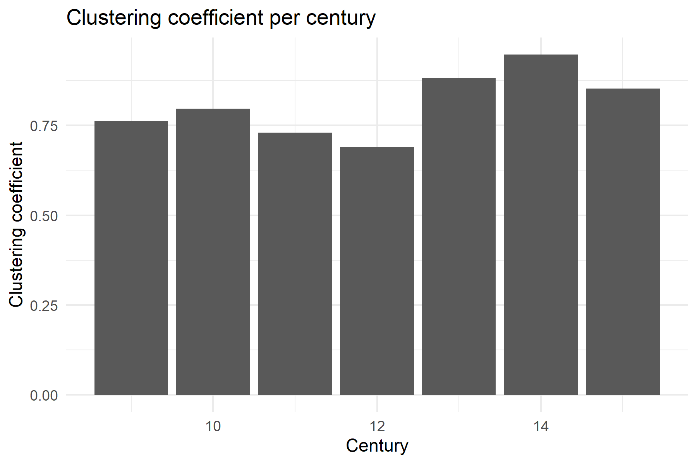

# Tracing the compiling strength of Augustine's Alleluia sermons

# Abstract

Modern editors of Augustine's sermons group manuscripts by named collections and use these groups to reconstruct the original text. This practice assumes that medieval compilers treated a collection as a unit. To tests that assumption for authentic Augustinian sermon collection De Alleluia, an antique collection of 47 sermons preserved in five manuscripts from northern France. To model the cooccurrence of sermons in manuscripts as a network: two sermons share a tie when manuscripts of a century combine them more often than a permutation null model predicts. The analysed network holds 284 sermons, the 51 Alleluia sermons and their direct neighbours, observed in four waves from the 9th to the 12th century. A stochastic actor oriented model (RSiena) estimates which pairs of sermons gain ties over time. Three findings stand out. Alleluia sermons form ties with each other more often than with other sermons, which supports the collection as a unit of selection. The subcollections of De Alleluia add a negligible effect beyond membership of the collection as a whole. Thematic similarity raises the chance of a tie, with collection membership under control. Shared membership of other collections, such as the derivative collections De lapsu mundi and Bruxelles, has the strongest effects. The model reproduces the observed networks poorly, so these results are tentative. The study shows how network models can test editorial categories across a whole corpus, and it points to bipartite and block models as the next step.

**Keywords:** Augustine, sermon collections, manuscript transmission, historical network research, stochastic actor oriented models

**Intended journal:** Journal for Historical Network Research (<https://jhnr.net/>)

# Introduction

The sermons on Augustine (d. 430) are one of most popular medieval sermons. From the point they were written down in the 5th century to the point Thomas Aquinas read one in the 13th century, it passed through a multitude of hands because every copy needed to be written by hand. Within this transmission process, sermons were compiled with multiple sermons, some consistently, and some (seemingly) random.

Previous scholarship (from the 13th century onward [ask Kendall exactly]) has defined these collection under specific names based on medieval named collections (e.g. De Verbis Domini) or manuscripts with many rare Augustinian sermons (e.g. Wolfenbuttel). Although the collections are apost-hoc construction, it is used for making editions of individual sermons. The underlying rational is that manuscripts with similar sermon configurations are like to be more closely related, and to reduce the number of transcriptions to be made, collections are the first step towards make the family tree (stemma) of a sermon. For example, sermons 251 and 250 have a stemma that is construed of manuscripts defined as A[lleluia]1 to 5 and P[aenetentia]1 to 3, named after collections. But are collections a valid category to reconstruct transmission? If that were the case, the configuaration of sermons within manuscripts should indicate the existence of those collections.

This practice rests on an assumption: medieval compilers treated a collection as a unit and copied its sermons together. If the assumption holds, the sermons of a collection appear together in manuscripts more often than chance predicts, and they keep doing so over the centuries. This study tests the assumption for one collection from late antiquity, De Alleluia.

De Alleluia counts 47 sermons and survives as a whole in five manuscripts from northern France, the oldest from the 9th century [@boodts2025]. Scholars divide it into subcollections: a spring series preached in Carthage in 418 (items 1 to 9), an Easter series from Hippo (items 10 to 19), a series preached after 425 (items 25 to 33) and a mixed part (items 20 to 24 and 34 to 47). Within the Easter series, nine sermons form a coherent series that Augustine preached during an Easter octave in Hippo, and manuscript Orléans 155 preserves the same sequence [@zwinggi]. Later medieval collections drew on De Alleluia, among them De lapsu mundi and the collection of Brussels (Bruxelles).

- The sermon are transmitted in small clusters [@macchioro2025][@schmidt_computational_2023]

- Sermons can be thematically clustered [@schmidt unpublished]

- Sets of sermons can be transmitted by other collection

- Two (high) medieval collections (e.g. Bruxelles and Lapsu Mundi) are textually dependent on De Alleluia

De Alleluia has defined subcollections rather than small clusters [@boodts2025]:

1.  Spring (Carthage, 418) (items 1-9)
2.  Easter (Hippo) (items 10-19)
3.  Winter (after 425) (items 25-33)

Next to the organised sets of the collections, some sermons are found as miscellaneous, described by De Coninck and Partoens [@ConinckFile] as mixed: items 20-24 and 34-47. Although, Verbraken suggested six additional sermons in between the mixed version.

We as historians can call these collections collections, but it is unclear to what extend these collections were relevant for compilation choices to creat a new manuscript.

## Scientific relevance

Two fields are approached. First the fields of philology and concerns the transmission of Augustine's sermons. Recent work shows that compilers customised collections for liturgical use and drew on existing repositories of excerpts [@macchioro2025]. The composition of sermon series within collections is itself a matter of debate [@drobner_treacherous_2022], and computational methods now make it possible to trace sermon collections across large corpora [@schmidt_computational_2023]. It is now possible to question to what extend these effect contribute to the formation of sermon manuscripts.

The second field is historical network research. Here, the question is raised to what extend stochastic actor oriented model SOAM is valiable for medieval manuscript studies, because manuscripts increasingly serve as network data [@stein_introduction_2023], and the PASSIM project already uses network visualisations to trace the textual connections of Augustinian sermons [@denis_pseudo-augustinian_2024]. Furthermore, a recent survey maps the practices and methods of the field [@weis_past_2025], and found little researchers working with SOAM. This study adds a statistical model of network change to that toolbox: the stochastic actor oriented model of [@snijdersIntroductionStochasticActorbased2010]. Applied to manuscripts, the model treats the corpus as one system. Each manuscript is a trace of a compiler's choice, and the pattern of all choices together shows which sermons were selected as a group.

### Research questions

1.  **RQ1 (descriptive).** How did the co-occurrence network of the sermons around De Alleluia change from the 9th to the 12th century, and how strongly did Alleluia sermons cluster together?
2.  **RQ2.** Were Alleluia sermons more likely to be compiled with other Alleluia sermons than with other sermons?
3.  **RQ3.** Were sermons of the same Alleluia subcollection more likely to be compiled together, beyond their membership of De Alleluia?
4.  **RQ4.** Did thematic similarity raise the chance that two sermons were compiled together?

# Hypotheses

If compilers copied De Alleluia as a unit, its sermons will travel together.

1.  **RQ2.** Alleluia sermons are more likely to form ties with other Alleluia sermons than with other sermons.

The subcollections are liturgical series or preached at the same time. A compiler who needed sermons for one season could lift such a series as a set. This leads to a stronger version of the exemplar route.

2.  **RQ3.** Sermons of the same Alleluia subcollection are more likely to form ties with each other, beyond their shared membership of De Alleluia.

Some manuscripts are compiled with the same subject matter in mind. Therefore, sermons with the same theme will be found in the same manuscript.

3.  **RQ4.** Thematically similar sermons are more likely to form ties.

### Control variables

Some sermon combinations will overlap with De Alleluia combinations. The known decedents of De Alleluia, namely Bruxelles and Lapsu Mundi in the 11th century, will potentially interfere with Alleluia sermon combinations. Therefore, they will be part of a control variable.

In addition, other collections that largely overlap with Alleluia will also be evaluated as control variable. The threshold is set on more than 6 sermons overlap with Alleluia. This yielded two sets of collections, one already present before the 9th century (Campanienne, Sessorienne, Verbis Apostoli (version A), and Verbis Domini (version B), and one from the 12th century onward (Sancti Catholici Patres, Diversis, Wolfenbuettel).

# Data

To make a unimode binary model, edges should not be regarded if they are a product of sermons or manuscripts with a large number of sermons, increasing the degree. For example, if I have two sermons that occur in 50% of the manuscript, they are very likely to occur together, because they are omnipresent. We want to analyse sermons that occur together that cannot be predicted by random change.

Therefore, a null model was created that filters edges that occur in more than 5% of randomly shuffled manuscripts. In other words, ties with a higher degree than 5% of 1000 random configurations.

This unimode model is created by a null model on bipartite manuscripts. The length of the sermon sequence is perserved, only the sermons are swapped between manuscripts. To this end, the sermons that are already swopped with not be swapped in the opposite direction, and are not the same. So, se1 and se1 are not swopped, and ms-se1 and ms2-se4 are swopped back on the next swopping round. There were 1000 swopping rounds per century.

This analysis is conducted on the 5% higher than random ties between sermons.

```{r setup, include=FALSE, warning=F, echo=F}
knitr::opts_chunk$set(echo = TRUE)
library(tidyverse)
library(readxl)
library(igraph)
library(parallel)
library(vegan)
library(kableExtra)

# check if packages are available
fpackage.check <- function(packages) {
    lapply(packages, FUN = function(x) {
        if (!require(x, character.only = TRUE)) {
            install.packages(x, dependencies = TRUE)
            library(x, character.only = TRUE)
        }
    })
}

len <- function (x) length(x)

packages = c("RSiena", "devtools", "igraph", "vegan")
fpackage.check(packages)

set.seed(24553253)

```

The EDA has shown that something changes in the clusters coefficient of the full network of sermons between 9-12th century and 13-16th century.

::: {.column width="50%"}

:::

To meet the ends of learning SIENA, analysing the manuscripts that are most used for editing purposes, and keeping a simple model, this analysis will be conducted on 9th to 12th century manuscripts.

Earlier centuries (5th to 8th) had a maximum of 17 manuscripts and didn't yield any more than 5% non-random sermon ties.

```{r load nodes edges, warning=F, echo=F}
root_data_path = "./data/data_deriv/"

# make matrix from csv matrix
load_adj_matrix <- function(file_name) {
  df <- read_csv(paste0(root_data_path, file_name), show_col_types = FALSE)
  
  nodes <- df[[1]]
  mx <- as.matrix(df[, -1])
  
  rownames(mx) <- nodes
  colnames(mx) <- colnames(df)[-1]
  
  return(mx)
}

# ======= WAVES ADJUNCTION MATRICES ==========
# 9TH TO 12TH CENTURY
se_adj_9_f = "se_se_filta5%_c9_adj_061026.csv" 
se_adj_10_f = "se_se_filta5%_c10_adj_061026.csv"
se_adj_11_f = "se_se_filta5%_c11_adj_061026.csv"
se_adj_12_f = "se_se_filta5%_c12_adj_061026.csv"

se_adj_9 <- load_adj_matrix(se_adj_9_f)
se_adj_10 <- load_adj_matrix(se_adj_10_f)
se_adj_11 <- load_adj_matrix(se_adj_11_f)
se_adj_12 <- load_adj_matrix(se_adj_12_f)

se_node_path = "se_nodes_colls_080926.xlsx"

# some nodes has duplicates and they are collapsed if one has 1 than 1 else 0 to be investigated
se_nodes <- read_excel(paste0(root_data_path, se_node_path)) |> 
  group_by(Id) |> 
  summarise(
    across(everything(), \(x) max(x, na.rm = TRUE)),
    .groups = "drop"
  )
# double checked and manually changed when necessary


```

```{r collection filter}
colls_df <- read_excel('./data/data_raw/collections.xlsx')
coll_ref_df <- read_excel('./data/data_raw/collections.xlsx', sheet="coll_cato") |> 
  mutate(century = as.integer(century)) |> 
  drop_na(century)

covar_colls_l <- lapply(colls_df, function(x) {
  x <- as.character(x)
  x[!is.na(x)]
})


# the alleluia sermons
allel_nodes <- se_nodes |> 
  filter(alleluia == 1) |> 
  pull(Id)

allel_nodes


```

# Network visualisation

### Alleluia in full network

To get a general idea of how alleluia is distributed in the general network. For clarity the nodes without edges are removed per plot.

```{r plot full}
# from matrix to igraph
g9 <- graph_from_adjacency_matrix(se_adj_9, 
                                  mode = "max", diag = F)
g10 <- graph_from_adjacency_matrix(se_adj_10, 
                                   mode = "max", diag = F)
g11 <- graph_from_adjacency_matrix(se_adj_11, 
                                   mode = "max", diag = F)
g12 <- graph_from_adjacency_matrix(se_adj_12, 
                                   mode = "max", diag = F)

plot_graph <- function (g, century, layout=NULL, size=200, clean=FALSE, color_nodes = list()){
  # which nodes to keep, if clean remove nodes with 0
  keep <- rep(TRUE, vcount(g))
  if (isTRUE(clean)) keep <- degree(g) > 0
  
  # remove unkept nodes
  g <- induced_subgraph(g, which(keep))
  
  if (is.null(layout)) layout <- layout_with_mds(g, dist = NULL, dim = 2)
  
  V(g)$size <- size
  
  # get allel color red
  alleluia_color <- ifelse(names(V(g)) %in% allel_nodes, "red", "lightgray")
  
  # plot century
  p1 <- plot(g,
    vertex.label = NA,
    vertex.color = adjustcolor(alleluia_color, alpha.f = 0.8),
    layout=layout,
    edge.width = 3,
    rescale=F,
    main=paste0("n=", length(V(g)), "; century=", century)
)
  p1
}

par(mfrow=c(2, 2), mar= c(1,1,1,1))

g_clean_list <- list(g9, g10, g11, g12)
cent_list <- 9:12

for (i in seq(length(g_clean_list))){
  g_i <- g_clean_list[[i]]
  cent <- cent_list[i]
  plot_graph(g=g_i, century=cent, clean=T, size=300)
}

coll

```

### Observations on overall network

The Alleluia collection occurs together, although not in full and separate. In any century, with this filter, the collection clusters separately and mostly with other sermons outside the collection. Apart from the 12th century, it appears that not all sermons have a degree with this filter.

### Alleluia subcollections plots

```{r subcollection plots}
# alleluia subcollections
allel_colls <- covar_colls_l[grepl("^alleluia_", names(covar_colls_l))]

# assign colours

coll_cols <- setNames(
  rainbow(length(allel_colls)),
  names(allel_colls)
)

# plot four centuries
g_list <- list(g9, g10, g11, g12)

par(mfrow = c(2, 2), mar = c(1, 1, 2, 1))

for (i in seq_along(g_list)) {

  g <- induced_subgraph(g_list[[i]], V(g_list[[i]])$name %in% allel_nodes)

  V(g)$color <- "lightgray"
  E(g)$color <- "black"

  for (c in names(allel_colls)) {
    V(g)$color[V(g)$name %in% allel_colls[[c]]] <- coll_cols[c]
  }

  plot(g,
       vertex.label = NA,
       vertex.size = 15,
       vertex.color = adjustcolor(V(g)$color, alpha.f = 0.8),
       edge.width = 2,
       layout = layout_with_mds(g),
       main = paste("Century", i + 8, "- n =", vcount(g)))
}

legend("bottomright", legend = names(coll_cols),
       col = coll_cols, pch = 19, bty = "n", cex = 0.7)


```

## Define the filter of sermons used for the analysis

The options are:

- Only alleluia sermons to get the model running and building the model

- Alleluia sermons and its direct (model=1) neighbours get test on a bigger model without overstraching the running capacity

- Use the full model.

```{r filters}
# ================== PARAMETERS ======================

# option: "alleluia" | "sample" | "neighbours" or somthing else
SIZE_RANDOM_SAMPLE = 100

mats <- list(
  se_adj_9,
  se_adj_10,
  se_adj_11,
  se_adj_12
)

# ==================== FUNCTIONS ===================
# drop nodes with no edges
ses_lists <- lapply(mats, function(m) {
  keep <- rowSums(m != 0) > 0 | colSums(m != 0) > 0
  m[keep, keep, drop = T]
  return (colnames(m))
})

# get the neighbours of alleluia nodes and return a list of unique neighbours
get_allel_sermons <- function(g, allel_nodes) {
  # overlap of alleluia nodes with nodes in the network
  non_missing_nodes <- intersect(allel_nodes, V(g)$name)
  
  # get neighbours
  nn_allel <- adjacent_vertices(g, v = non_missing_nodes, mode = "all")
  
  # put nn in list
  allel_nn_nodes <- list()

  for (nn in nn_allel) {
    if (!is.null(names(nn))) {
      allel_nn_nodes <- append(allel_nn_nodes, as.list(names(nn)))
    }
  }

  # unlist and make unique
  unique(unlist(allel_nn_nodes))
}

# ============== TYPES OF NODE FILTERS ===============
## ALL SERMONS WITH EDGES
all_node_sermons <- unique(unlist(ses_lists))

## RANDOM SAMPLE OF N SERMONS
# a random sample of sermons (n=100)
sample_vec <- all_node_sermons |> 
  as.data.frame() |> 
  slice_sample(n=100) |> 
  as.list()

## ONLY ALLELUIA SERMONS
# alleluia sermons
allel_nodes <- se_nodes |> 
  filter(alleluia == 1) |> 
  pull(Id)

## ALLELUIA NEIGHBOURS MODE=1
# get set of all centuries
allel_sermons <- unique(c(
  get_allel_sermons(g9, allel_nodes),
  get_allel_sermons(g10, allel_nodes),
  get_allel_sermons(g11, allel_nodes),
  get_allel_sermons(g12, allel_nodes),
  allel_nodes
))

print(paste("N only alleluia sermons:", length(allel_nodes)))
print(paste("N direct neighbours Alleluia sermons:", length(allel_sermons)))
print(paste("N random sample:", length(sample_vec$all_node_sermons)))
print(paste("All sermons:", length(all_node_sermons)))

# ===================== FILTER ==================

FILTER_TYPE <- "neighbours"

# option: "alleluia" | "sample" | "neighbours" or somthing else
# the alleluia sermons
if (FILTER_TYPE == "alleluia"){
  filter_sermons <- allel_nodes
} else if (FILTER_TYPE == "sample"){
  filter_sermons <- sample_vec$all_node_sermons
} else if (FILTER_TYPE == "neighbours"){
   filter_sermons <- allel_sermons
} else filter_sermons <- all_node_sermons

print(paste("Filter type:", FILTER_TYPE))
```

```{r node sync}
# filter on relevant nodes
df <- se_nodes |> 
  filter(Id %in% filter_sermons)

# sermons with ties that lack a row in se_nodes
setdiff(filter_sermons, se_nodes$Id)

# pad a matrix to the full set of ids, filling gaps with 0
pad_matrix = function(m, ids) {
  out = matrix(0, nrow = length(ids), ncol = length(ids),
               dimnames = list(ids, ids))
  shared = intersect(ids, rownames(m))
  out[shared, shared] = m[shared, shared]
  out[is.na(out)] = 0
  diag(out) = 0
  out
}

mats_sync = lapply(mats, pad_matrix, ids = df$Id)

# make matrix waves
wave_9  <- mats_sync[[1]]
wave_10 <- mats_sync[[2]]
wave_11 <- mats_sync[[3]]
wave_12 <- mats_sync[[4]]

# uniform the waves with the node attibutions
wave_9 <- wave_9[df$Id, df$Id, drop = FALSE]
wave_10 <- wave_10[df$Id, df$Id, drop = FALSE]
wave_11 <- wave_11[df$Id, df$Id, drop = FALSE]
wave_12 <- wave_12[df$Id, df$Id, drop = FALSE]


# print identical nodes to next wave
identical(rownames(wave_9), rownames(wave_10))
identical(rownames(wave_10), rownames(wave_11))
identical(rownames(wave_11), rownames(wave_12))

isSymmetric(wave_12)

```

```{r eda sync}
g9_sync <- graph_from_adjacency_matrix(wave_9, mode = "max", diag = F)
g10_sync <- graph_from_adjacency_matrix(wave_10, mode = "max", diag = F) 
g11_sync <- graph_from_adjacency_matrix(wave_11, mode = "max", diag = F) 
g12_sync <- graph_from_adjacency_matrix(wave_12, mode = "max", diag = F)


g_full <- list(g9_sync, g10_sync, g11_sync, g12_sync)
centuries <- seq(9, 12)

par(mfrow=c(2, 2), mar= c(1,1,1,1))
stable_layout <- layout_with_mds(g12_sync, dist = NULL, dim = 2)

for (i in seq(length(g_clean_list))){
  g_i <- g_full[[i]]
  cent <- cent_list[i]
  
  size <- ifelse(cent %in% 11:12, 400, 300)
  
  plot_graph(g_i, century=cent, layout = NULL, size=size, clean=T)
}

mtext("Filtered network", side = 3, line = 0, outer = TRUE)


```

```{r dyad count plot}
alleluia_counts <- sapply(g_full, function(g) {
  e <- ends(g, E(g), names = TRUE)
  a <- e[, 1] %in% allel_nodes
  b <- e[, 2] %in% allel_nodes

  c(
    "A–A" = sum(a & b),
    "A–NonA" = sum(a != b),
    "NonA–NonA" = sum(!a & !b)
  )
})

colnames(alleluia_counts) <- 9:12
alleluia_counts <- as.data.frame(alleluia_counts)
alleluia_counts <- data.frame(type = rownames(alleluia_counts), alleluia_counts,row.names = NULL)

counts_long <- alleluia_counts |>
  pivot_longer(-type, names_to = "century", values_to = "count") |> 
  mutate(century = factor(century,levels = c("X9", "X10", "X11", "X12")))

ggplot(counts_long, aes(x = century, y = count, fill = type)) +
  geom_col(position = "fill") +
  labs(x = "Century", y = "Number of edges (%)", fill = "Edge type",
       title = "Edge distribution Alleluia with non-Alleluia sermons",
       subtitle = "Sliced network on Alleluia sermons with neighbours") +
  theme_minimal()

```

```{r filtered statistics}
# get n nodes (removed if degree = 0)
century_count <- function (g_i, cent) {
  n_unq_mss = length(unique(E(g_i)$manuscript))
  
  # voeg een weight toe
  E(g_i)$weight = 1
  
  g_i <- simplify(g_i, edge.attr.comb = list(weight = "sum"))
  
  # normalise weight
  E(g_i)$weight <- E(g_i)$weight / max(E(g_i)$weight)
  avg_edges <- if(n_unq_mss > 0) ecount(g_i) / n_unq_mss else 0
  
  return(data.frame(
    Century = cent,
    Nodes = vcount(g_i),
    Edges = ecount(g_i),
    Degree = igraph::mean_degree(g_i),
    Transitivity = igraph::transitivity(g_i, type = "global"),
    Density = igraph::edge_density(g_i),
    stringsAsFactors = FALSE
  ))
}

df_results <- do.call(rbind, lapply(seq_along(g_full), function(i) {
  century_count(g_i = g_full[[i]], cent = centuries[i])
}))

knitr::kable(df_results)

```

### EDA comparative

When comparing the EDA of the weighted full network with the not-random network, a few things stick out on the three measurements: Degree, Transitivity, and Density. Degree, the number of degrees is far lower, which totally is expected when removing 95% of the edges that could also be attributed to random selection. Transitivity, the global transitivity or clustering coeffient is higher in the 10 and 11th century compared to the full graph. Furthermore, the decline we see in clustering in the full model is not translated into the non-random model. The 10th century shows three distinct clusters with a few isolated triplets and doubles, which result in a high potential for fully connected triplets. Density, the density is far lower than the fully connected model. This is to be expected for the same reason as lower degree.

In answer to RQ1, the network around De Alleluia grows from a sparse set of ties in the 9th century into a dense and clustered network in the 12th. Alleluia sermons cluster in part, and most of their ties connect them to other collections, especially in the 12th century.

## Maintenance

The question is if the number of connects remain the same ones formed. First have a look to what extent this happens.

```{r maintance}
waves = list(wave_9 = wave_9, wave_10 = wave_10, wave_11 = wave_11, wave_12 = wave_12)

changes <- do.call(rbind, lapply(1:3, function(i){
  a = waves[[i]]
  b = waves[[i+1]]
  
  tri <- upper.tri(a)
  data.frame(
    period = paste(i, names(waves)[i], "-", names(waves)[i + 1]),
    created    = sum(a[tri] == 0 & b[tri] == 1),
    dissolved  = sum(a[tri] == 1 & b[tri] == 0),
    maintained = sum(a[tri] == 1 & b[tri] == 1)
  )
}))

print(changes)

changes_long <- pivot_longer(changes, cols = c(maintained, created, dissolved),
                    names_to = "change", values_to = "ties")

ggplot(changes_long, aes(x = period, y = ties, fill = change)) +
  geom_col() +
  labs(x = NULL, y = "Number of ties", fill = NULL,
       title = "Tie maintenance 9th - 12th century") +
  theme_minimal() 

```

### Which collection could influence the alleluia corpus?

Other collections might be influencing the results of alleluia sermon connecting. Those, we need a list of sermons-sermon edges that occur in alleluia in the data, and not theoretical as shown above, and if those edges also occur in another collection.

```{r alleluia edges and collection overlap}
get_coll_overlap <- function (m, colls, relv_cs) {
  g_a <- graph_from_adjacency_matrix(m, mode='undirected', diag = F)
  
  coll_list <- list()
  
  edges <- igraph::as_edgelist(g_a, names = TRUE)
  print(paste(len(edges), len(E(g_a))))
  
  overlap_counts <- integer(0)

  for (c in names(colls)) {
    
    if (c %in% relv_cs){
  
    count <- 0
  
    for (i in seq_len(nrow(edges))) {
  
      e1 <- edges[i, 1]
      e2 <- edges[i, 2]
  
      if (e1 %in% colls[[c]] && e2 %in% colls[[c]]) {
        count <- count + 1
      }
  
    }
  
    if (count > 0) overlap_counts[c] <- count
    }
  }
  
  overlap_counts <- sort(overlap_counts, decreasing = TRUE)

  print(overlap_counts)
  print(paste(nrow(edges), "total edges"))
  
  return (names(overlap_counts))
}

get_relv_coll_cent <- function (df, cent) df |> 
    filter(century < cent + 1,
           !str_detect(collection, "^(alleluia|brux|lapsu|scp_verbraken)")) |> 
    pull(collection)

mats_full_allel = lapply(mats, pad_matrix, ids = allel_nodes)
cent_list = 9:12


overlap_l <- list()

for (i in seq_len(len(mats_full_allel))) {
  c = cent_list[i]
  m = mats_full_allel[[i]]
  
  # get potential/existing collections in that century
  relv_cent_colls <- get_relv_coll_cent(coll_ref_df, c)
  
  # get collection names with overlapping sermon pairs
  coll_names_overlap <- get_coll_overlap(m, covar_colls_l, relv_cent_colls)
  
  overlap_l[[c]] <- coll_names_overlap
}

overlap_l
```

# Thematic

1.  The sermons are scraped from augustinus.it. (<https://www.augustinus.it/latino/discorsi/>)
2.  Stanza (stanfort NLP package) is used as embedder, because latincy caused errors.
3.  Texts were lemmatised and filtered.
    1.  Stopwords removed (list from KotobaTrilius)
    2.  POS: "NOUN", "VERB", "ADJ", "PROPN" kept
    3.  Words occuring in more than 50% of sermons
    4.  Words occuring in less than 5 sermons.
    5.  lemmas smaller than 3 characters are removed
4.  words are vectored with TF-IDF (1)
5.  Similarity matrix is created by cosine similarity between each sermon.
6.  for t = lemma and d = document and n = number of times

(n times t in d / total n ts in d) \* log (total number of d / n d containing t)

[https://raw.githubusercontent.com/KotobaTrilius/latin-stopwords/main/latin](https://raw.githubusercontent.com/KotobaTrilius/latin-stopwords/main/latin%22)

### Mantel permutation

To quickly validate the potential influence of thematic similarity, the edges of alleluia sermons are correlated to thematic distance with mantel permutations. To this end, spearman will be used because we assume a monotonic and not linear relationship, which is good enough for a simple check.

```{r plots}
theme_sim_m <- load_adj_matrix('alleluia_similarity_matrix.csv')

mantel_results <- list()
cent_list <- 9:12

for (i in seq_len(len(mats_full_allel))) {
  
  c <- cent_list[i]
  m <- mats_full_allel[[i]]
  
  ids <- intersect(rownames(m), rownames(theme_sim_m))
  
  print(c)
  
  mantel_results[[as.character(c)]] <- vegan::mantel(
    as.dist(1 - m[ids, ids]),
    as.dist(1 - theme_sim_m[ids, ids]),
    method = "spearman",
    permutations = 9999
  )
  
  print(mantel_results[[as.character(c)]])
}

mantel_stats <- numeric(0)

for (c in names(mantel_results)) {
  mantel_stats[c] <- mantel_results[[c]]$statistic
}

plot(
  as.numeric(names(mantel_stats)),
  mantel_stats,
  type = "b",
  xlab = "Century",
  ylab = "Mantel correlation (Spearman)",
  main = "Similarity between alleluia and thematic networks"
)
```

The results are interesting. First the 9th century shows a insignficant and weak relationship between thema and non-random alleluia edges. The relationship between the Alleluia sermons is often less thematically related. Furthermore, the manuscripts in the 9th century are the Alleluia collection manuscripts. Therefore, it is logical to find no significant thematic relationship.

The 10th century has no significant results, because their as so little edges between alleluia sermons.

The 11th century has signficantly results with again that mixed? cluster and a Easter cluster. Although again weak relationship.

Interestingly, the 12th century has no relationship between thematic clusters but has a lot of non-random edges. This would indicate that no prove of thematic correlation is found within this dataset, indication another edge-making mechanism at work.

It seems informative to introduce thematic similarity into the analysis but with a time dummy.

# RSiena

One big discussing point here. The network shows almost no breaking of ties between the waves. The model is breaking, maintaining, or addition ties to form the observed network, stepwise. However, the observed model doesn't work that way, because it is a projected single model network from a bipartite network, the edges are form simultaneously, resulting in high clustering networks that behave per definition differently. Consequently, the model has a hard time converging and approximating the observed network with it runs. Therefore, I would argue it is justified to simplify the model to a only adding model although this is non-conform theory were sermons could be disentangled in the scribe's eye. The marginal error will be small to produce a model that is better at simulating the observed networks than without.

Furthermore, the model yields NA's on testing the subcollection in the std's. Probablity because the model doesn't converge. Therefore, the research question is formulated more abstractly, to investiguate whether or not the subcollections in general are more influential in forming connections than Alleluia. To differentiate between the two, the model will test on tie dummies instead of node dummies. Because indivial nodes of subcollections dont converge, because making all subcollection one dummy of subcollection yields exactly the same as the alleluia dummy because the nodes are the same. Theoretically, the subcollection property lays within the sermon, not in the tie. A scribe would select two sermons and not a manuscript with the two sermons (is the hypothesis). However, this simplification reduces the model's dimensionality and retains the difference between alleluia collection and subcollections.

```{r only additional}
net_soc_array <- array(data = c(wave_9, wave_10, wave_11, wave_12), dim = c(dim(wave_9), 4))

# change maximum of both matrices (only increasing)
for (t in 2:dim(net_soc_array)[3]) {
  net_soc_array[, , t] <- pmax(net_soc_array[, , t], net_soc_array[, , t - 1])
}

# dependent
net <- sienaDependent(net_soc_array, type = "oneMode",
                      allowOnly = TRUE)

net
```

```{r thematic matrix}
# align
ids <- rownames(wave_9)

# slice on ids 
sim <- theme_sim_m[ids, ids]

# sim z-score
sim <- (sim - mean(sim[upper.tri(sim)])) /
       sd(sim[upper.tri(sim)])

diag(sim) <- 0


# z-score
sim <- (sim - mean(sim[upper.tri(sim)])) /
       sd(sim[upper.tri(sim)])

diag(sim) <- 0

mean(sim)
```

```{r model schatten}
df <- se_nodes |>
  filter(Id %in% rownames(wave_9))

# return present in collection [0,1] 
in_collection <- function (col){
  x <- df[[col]] == 1
  x[is.na(x)] <- F
  as.numeric(x)
}

# add coCovar for each collection on node level
node_dummy <- function(cols) {
  x <- rep(0, nrow(df))
  
  for (col in cols) x[in_collection(col) == 1] <- 1
  coCovar(x)
}

# return matrix of shared edges of collections
pair_share <- function(cols) {
  n <- nrow(df)
  m <- matrix(0, n, n)
  for (col in cols) {
    members <- in_collection(col) == 1
    m[members, members] <- 1
  }
  diag(m) <- 0
  m
}

# add coVar on dyad level for every wave
pair_share_periods <- function(cols_p1, cols_p2, cols_p3) {
  n <- nrow(df)
  empty <- matrix(0, n, n)

  m1 <- if (length(cols_p1) == 0) empty else pair_share(cols_p1)
  m2 <- if (length(cols_p2) == 0) empty else pair_share(cols_p2)
  m3 <- if (length(cols_p3) == 0) empty else pair_share(cols_p3)

  varDyadCovar(array(c(m1, m2, m3), dim = c(n, n, 3)))
}

# ===========================================================
a_sub_cols <- c("alleluia_spring", "alleluia_easter", "alleluia_after_425", "alleluia_mixed?") # mixed is covered by mixed?

controle_cols <- c("campanienne", "sessorienne", "va_a", "va_b") # > 6 overlap from 9th onwards

desc_cols <- c("lapsu", "bruxelles")
later_cols <- c("scp", "diversis", "wolfenbuettel") # > 15 overlap on 12th century

mydata <- sienaDataCreate(
  net        = net,
  alleluia   = node_dummy("alleluia"),
  same_Asubs = coDyadCovar(pair_share(a_sub_cols)),
  c912cols   = coDyadCovar(pair_share(controle_cols)),
  desc       = pair_share_periods(c(), desc_cols, desc_cols),
  c12cols    = pair_share_periods(c(), c(), later_cols),
  theme      = coDyadCovar(sim)
)

print01Report(mydata, modelname = "./results/Alle7")

attr(mydata$depvars$net, "uponly")
```

```{r model en goodness of fit}
# get new project
myAlg   <- sienaAlgorithmCreate(projname = "./results/Alle7_model1")
n_cores <- detectCores() - 1

# run model with time on density 
est_model <- function(eff, prev = NULL, thetaBound = 150) {
  siena07(myAlg, data = mydata, effects = eff,
          returnDeps = TRUE, useCluster = TRUE, nbrNodes = n_cores,
          thetaBound = thetaBound, prevAns = prev)
}

# limit degree validation by only looking at 0 to 25 degrees
DegreeDist0to100 <- function(i, obsData, sims, period, groupName, varName, ...) {
  IndegreeDistribution(i, obsData, sims, period, groupName, varName, levls = seq(0, 25, by = 1))
}

# get undirected triad census
TriadUndir <- function(i, obsData, sims, period, groupName, varName, ...) {
  a <- as.matrix(sparseMatrixExtraction(i, obsData, sims, period, groupName, varName))
  g <- graph_from_adjacency_matrix(a)
  tc <- triad_census(g)
  c("003"=tc[1], "102"=tc[3], "201"=tc[11], "300"=tc[16])
}

gof_triads <- function(ans) {
  sienaGOF(ans, TriadUndir, verbose = TRUE, join = FALSE,
           varName = "net", period = 1:3, twoTailed = FALSE)
}

gof_degree <- function(ans) {
  sienaGOF(ans, DegreeDist0to100, verbose = TRUE, join = FALSE,
           varName = "net", period = 1:3, twoTailed = FALSE)
}

```

## Results

```{r model 0}
eff0 <- getEffects(mydata)

eff0 <- includeEffects(eff0, transTies, timeDummy = "all")

# (ans0 <- est_model(eff0, thetaBound = 150))
# 
# gof0.degree <- gof_degree(ans0)
# gof0.triads <- gof_triads(ans0)
# 
# for (p in 1:3) print(plot(gof0.degree, scale = TRUE, center = TRUE, period = p))
# 
# for (p in 1:3) print(plot(gof0.triads, scale = TRUE, center = T, period = p))
# 
# gof0.degree
# gof0.triads


```

```{r model 1 effects}
# RQ1: Is Alleluia sermons more likely to connect with Alleluia sermons or rather with other sermons?
eff1 <- includeEffects(eff0, egoPlusAltX, egoXaltX, interaction1 = "alleluia")

# RQ2: Are subcollections of Alleluia more prominent to connect with each other rather than Alleluia sermons. 
eff1 <- includeEffects(eff1, X, interaction1 = "same_Asubs")

# controle collections
for (covar in c("c912cols", "desc", "c12cols")) eff1 <- includeEffects(eff1, X, interaction1 = covar)

# theme added 
eff1 <- includeEffects(eff1, X, interaction1 = "theme")
eff1
```

```{r goodness of fit}
# (ans1 <- est_model(eff1, thetaBound = 150))
# 
# gof1.degree <- gof_degree(ans1)
# gof1.triads <- gof_triads(ans1)
# 
# for (p in 1:3) print(plot(gof1.degree, scale = TRUE, center = TRUE, period = p))
# 
# for (p in 1:3) print(plot(gof1.triads, scale = TRUE, center = T, period = p))
# 
# gof1.degree
# gof1.triads
```

```{r model 2}
eff2 <- setEffect(eff1, X, interaction1 = "c12cols", fix = TRUE, initialValue = 10)
eff2 <- setEffect(eff2, transTies, initialValue = 5.8, fix = FALSE)

# (ans2 <- est_model(eff2, thetaBound = 150, prev = ans1))
# 
# ans2
# 
# gof2.degree <- gof_degree(ans2)
# gof2.triads <- gof_triads(ans2)
# 
# for (p in 1:3) print(plot(gof2.degree, scale = TRUE, center = TRUE, period = p))
# 
# for (p in 1:3) print(plot(gof2.triads, scale = TRUE, center = T, period = p))
# 
# gof2.degree
# gof2.triads


```

```{r restults table}
t <- data.frame(
  effect = c("Rate period 1 (9th to 10th)", "Rate period 2 (10th to 11th)",
             "Rate period 3 (11th to 12th)", "Transitive ties",
             "Alleluia ego plus alter", "Alleluia ego × Alleluia alter",
             "Same subcollection", "Thematic similarity (per SD)",
             "Shared older collection", "Shared derivative collection",
             "Shared 12th century collection",
             "Overall maximum convergence ratio"),
  tests = c("", "", "", "Control", "H1", "H1", "H2", "H3",
            "Control", "Control", "Control", ""),
  `model 0` = c("4.65 (0.13)", "2.81 (0.10)", "14.49 (0.23)", "5.81 (0.64)",
                "", "", "", "", "", "", "", "0.248"),
  `model 1` = c("8.50 (0.32)", "5.08 (0.22)", "15.82 (0.28)", "9.51 (4.71)",
                "−0.90 (0.13)", "1.73 (0.26)", "−0.05 (0.33)", "0.222 (0.031)",
                "2.60 (0.18)", "2.55 (0.26)", "125.1 (5.9)", "2.933"),
  `model 1.2` = c("8.46 (0.32)", "5.06 (0.21)", "15.84 (0.28)", "9.51 (fixed)",
                  "−0.97 (0.11)", "1.69 (0.23)", "0.10 (0.33)", "0.235 (0.024)",
                  "2.61 (0.20)", "2.57 (0.21)", "125.1 (fixed)", "0.114"),
  `model 1.2: z outcome` = c("", "", "", "", "−8.55", "7.33", "0.30", "10.00",
                     "13.08", "12.52", "", ""),
  check.names = FALSE
)
kable(t, caption = "RSiena estimates with standard errors in brackets. Alleluia sermons with direct neighbours: 284 sermons.")

```

### Model short evaluation

The zero model is the simplest model possible. To indicate whether the clustering prediction holds. Three times p\<0.001 difference is worrying because the model is so simple. Furthermore, the MDH = \~[4300, 87000] which is enormous.

The first model doesn't converge at all, (2.93) and that has to do with the collections in the 12th century. They overlap strongly with the existing model, and predict thus too well. The leap from wave 11 to 12 increases a lot of ties, so the model needs to work hard towards adding new ties and because the big collections like SCP were very popular it fits very well.

The last model is described with the three research questions in mind. It needs to be said that the goodness of fit is rather terrible and no conclusion can be drawn from this analysis. The model does converge on (0.11).

### Model 1.2 conclusions

The three research questions are combined into one model. It needs to be said that the goodness of fit is rather terrible and no conclusion can be drawn from this analysis. The model does converge on (0.11).

However, would that be the cause, this would be my interpretation.

RQ2: Something that I didn't expect, but Alleluia shows a positive effect of connecting with sermons from alleluia (z=7.33) and a negative effect of forming edge with sermons outside collection (z = -8.55).

RQ3: The subcollections are not more likely to be form a tie compared to between subcollections or other sermons (z = 0.30). The thematic overlap between the addition in Mixed? and the thematic overlap exhibited in that subcollection, may have influenced the low result of this analysis.

RQ4: Thematic similarity is an significant (z = 9.99) factor to form ties in the next phase.

# Discussion

### Potential problems:

- the transitive ties are frozen in the second run.
- the goodness of fit is significantly different, changing per wave the number of triads and singles, and the degree is seriously off. I think it is difficult for the model to stocastically work on a "edge-adding" model when it is estimated in projected network.
- The assumption of causality is probablity wrong. The model implices wave2 is caused by wave1 + ties, but on a microlevel this assumption doesn't hold, because the ties are created by non-random estimation of the sum of different ties. One tie reflects the relationship between ties of the network as well as a summation of multiple manuscripts that could be written in an unrelated context. For example: baltics 1010 monestary and secular scriptorium against the Notre dame in 1090.
- Put differently, the sermons are not necessary aware of the existence of other sermons (some sermons are out of scope from the datasets we have, and may be less copied)

# Conclusion

## Thoughts of next steps

One of the strongest ideas is the estimation of effects to predict next distributions. SIENA does this really well. The translations however from macro to micro and back is difficult due to the nature of the source material.

I've learned that a model should resemble the data as close as possible, and I'm also very grateful for Koolman's boat, which is a strong methodological tool.
